# What makes a Magic card expensive?

I wanted to know which parts of a Magic card tell me something about its paper price. Take flying. I can count how many creatures have it and look up what they cost. But what if the flyers also happen to be rarer, or turn up in more tournament decks? I wanted to see how much of the price gap was left once I accounted for those things.

I used December 2025 for the prices. I had to settle on a printing first. My Ixalan file has 289 printing records for 274 names. All 15 extra rows come from the five basic lands, with four illustrations each. For the feature regressions below I took one regular printing per name. For a set binder I used the printing from that set. For the over-a-dollar collection I looked for the cheapest copy in the archive. [Original Ixalan file](https://github.com/UaDreamota/mtg_assetpricing/blob/b1653b98b2f724d8e7c361baa5ba463800796604/data/xln_cards.csv)

[First results](#first-results) · [Card counts, words and mana](#what-did-each-color-get) · [Expansion prices](#what-did-an-expansion-cost) · [The top 300](#how-much-of-the-over-a-dollar-collection-sits-in-300-cards) · [The 15-word cutoff](#are-creatures-or-wordier-cards-more-expensive)

## First results

If I could look at one thing on the card, I’d start with rarity. A mythic creature had about 6.9 times the fitted price of a comparable common. Among noncreatures, enchantments came in about 16% above sorceries. Having blue among a card’s colors went with about a 20% lower price in that same fit. Ten extra rules words went with a smaller difference, about 3% lower for creatures and 7% lower for noncreatures. I couldn’t pick out a price premium for any one of the 16 creature keywords. But creatures whose text said they could *produce mana* were about 27% more expensive, even after the same controls.

I fit separate regressions for creatures and noncreatures. Each name contributes its oldest regular expansion printing with a qualifying paper quote. I took the median of its daily quotes in the last week of December and required three quoted days. My starting model knew the expansion, rarity, the fraction of downloaded Standard lists that contained the card, estimated supply, and how many covered expansions printed it. Then I gave it the card features. I held out whole names in five folds within each expansion.

| December sample | Names | Expansions | Held-out R², starting model | With card features |
|---|---:|---:|---:|---:|
| Creatures with numeric power and toughness | 6,424 | 58 | 0.626 | 0.633 |
| Single-type noncreatures | 5,862 | 58 | 0.511 | 0.554 |

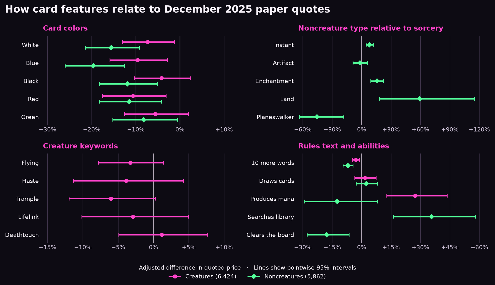

### Color and mana cost

I gave each of the five colors its own column. A blue-red card switches on both blue and red. So the blue estimate compares cards with and without blue, holding the other four color flags, mana value, colored mana symbols and the other measured features fixed. The multicolor category I use to count designs later would answer a different question.

| Color present | Creature quote | Noncreature quote |
|---|---:|---:|
| White | −7.4% | −15.6% |
| Blue | −9.6% | −19.6% |
| Black | −4.2% | −11.9% |
| Red | −10.7% | −11.5% |
| Green | −5.6% | −8.2% |

For blue the 95% interval was −15.9% to −2.8% among creatures and −26.0% to −12.6% among noncreatures. I’d be less confident about the green creature estimate, where the interval ran from −12.6% to +1.9%. An extra point of mana value had almost no estimated difference for creatures once I held power and toughness fixed (+0.3%). For noncreature spells it went with a 3.4% lower quote.

### Card type

I started with the observed geometric mean price for each noncreature type relative to sorceries. Then I compared them inside the same regression. The reference spell costs three mana with one colored symbol. The reference planeswalker starts with three loyalty. Lands have their own type indicator and the spell-cost terms apply only to nonlands.

| Compared with a sorcery | Raw price gap | After controls | 95% interval after controls |
|---|---:|---:|---:|
| Instant | −15.9% | +7.9% | +4.3% to +11.6% |
| Artifact | +22.5% | −1.8% | −8.9% to +5.8% |
| Enchantment | +25.6% | +15.6% | +9.2% to +22.4% |
| Land | +112.9% | +59.4% | +18.0% to +115.2% |
| Planeswalker | +409.5% | −45.5% | −63.7% to −18.3% |

The planeswalker row made me go back and count the cards. All 44 planeswalkers were legendary. Of the 1,463 sorceries, only six were legendary. I’m asking the model to hold legendary status fixed in a comparison where there’s very little overlap. I’d put more weight on the instant comparison, with 1,746 instants in the sample.

### Rules text, keywords and what the card does

I removed the text in parentheses and counted the remaining rules words in tens. With word count as the only predictor, ten extra words went with 21.8% higher creature quotes and 15.0% higher noncreature quotes. With the full controls those estimates came to −3.0% (95% interval −4.7% to −1.2%) and −7.0% (−9.5% to −4.4%). I come back to this below because my original “more than 15 words” test gives a very different answer among cards seen in Standard.

Flying is a good example of what happened with the keywords. I had 1,108 flying creatures, and their geometric mean quote was 18.7% higher than for creatures without flying. After adjustment I got −3.3%, with an interval from −7.8% to +1.4%. Trample went from +23.3% to −6.0%. All 16 individual keyword intervals included zero. Some were very wide. Only 16 creatures had indestructible, and its adjusted interval ran from 18% cheaper to 132% more expensive.

I also searched the text for things cards actually do. The 206 creatures flagged for producing mana were 27.2% more expensive after adjustment (+12.8% to +43.5%). Among noncreatures, the 208 that let you search your library were 35.6% higher (+16.3% to +58.1%). Text that destroys or exiles everything, or deals damage to each creature, went with a 17.8% lower quote (−27.8% to −6.4%). These are text patterns, so a card can count in several groups. [All feature estimates, comparisons and intervals](results/card_table/feature-effects.csv)

### How much did play and supply matter?

Going from no appearances to appearing in 1% of the downloaded Standard lists went with a 54.2% higher creature quote (+40.1% to +69.6%) and a 38.9% higher noncreature quote (+28.1% to +50.5%). Doubling estimated expansion supply went with 10.5% and 13.0% lower quotes respectively. The creature supply interval included zero. I estimated copies from release-family revenue and booster rarity slots, so I have more uncertainty here than I do about what color a card is. [Expansion supply inputs](data/expansion_sizes.csv)

There are individual cards where I miss by quite a lot. *Llanowar Elves* appeared in 20.9% of the Standard lists. Its printing was quoted at 30¢ and the model put it at \$1.75 with the name held out. *Mox Opal* had zero Standard appearances and a \$187.01 quote against a fitted \$5.33. Both get a mana-production flag. The regressions have separate terms for cost and abilities, and only measure play in one format. [Saved fits and individual card estimates](results/card_table/prices.json)

[Equation, coefficients and p-values](#how-much-text-how-many-keywords-how-much-mana)


## What did each color get?

I counted 30,901 distinct designs in the broader catalog. A blue-red card goes in the multicolor column, and an artifact creature counts in both of its type rows. The numbers in the figure are counts. I shaded them by share of the column so I could see, for example, what fraction of green is creatures. [Type-by-color counts](results/exploration/type-color-counts.csv)

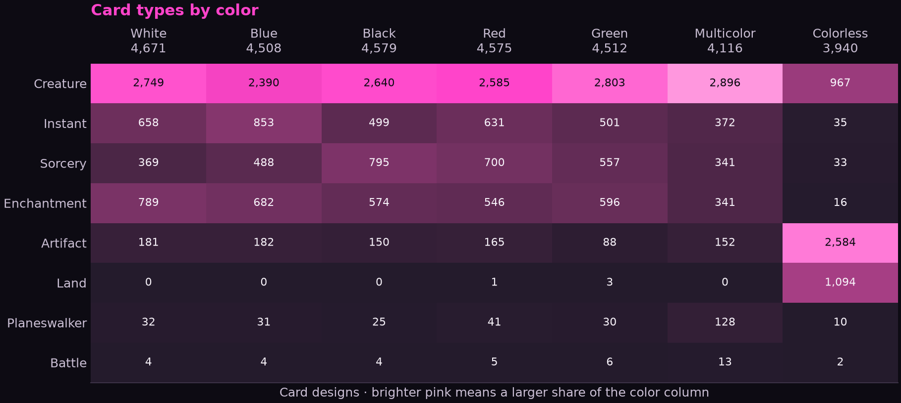

Of the 17,030 creatures, 2,803 are green alone. That’s 62% of the green column. Blue has 853 instants and 488 sorceries. White has 789 enchantments. Of the 297 planeswalkers, 128 are multicolor.

### How much text, how many keywords, how much mana?

The count I wanted first was words per card. The price question is a little different. If two spells cost the same mana and show up in decks about as often, does the one with another ten words of text tend to cost more?

For each group I fit ordinary least squares to the natural log of its printing’s paper quote `q`. Here `s(i)` is the expansion, `R` is rarity (common is the reference), `d` is the fraction of that month’s downloaded Standard lists containing the name, `S` is estimated cumulative supply across covered expansions and `J` counts those expansion issues.

```math
\ln q_i=\alpha_{s(i)}+\rho^\top R_i+\beta_d\ln(1+100d_i)+\beta_s\log_2 S_i+\beta_j\log_2 J_i+\theta^\top Z_i+\epsilon_i.
```

The starting model omits the card features `Z`. For creatures I added mana value, colors, colored symbols, numeric power and toughness, rules words in tens, legendary status, 16 keywords and four text roles. For noncreatures I used type, colors, spell mana value and colored symbols, rules words in tens, legendary status, nine text roles and planeswalker starting loyalty.

Going from 0% to 1% of decks changes the play term by `ln 2`. I clustered standard errors by expansion (58 clusters). [Regression code](scripts/analysis/card_prices.py)

Here are the slopes from the December card index. The outcome is log price, so the interval and β are in log points. The last column is `100 × (exp(β) − 1)`. Each interval covers one coefficient at a time. Each p-value is from a two-sided test of β = 0 with 57 degrees of freedom. I haven’t adjusted them for the number of features I tried.

| Feature | Fit | β | Clustered SE | 95% CI for β | p | Price difference |
|---|---|---:|---:|---:|---:|---:|
| 10 more rules words | Creatures | −0.0301 | 0.0092 | −0.0486 to −0.0117 | 0.00177 | −3.0% |
| 10 more rules words | Noncreatures | −0.0727 | 0.0137 | −0.1001 to −0.0452 | 1.96e−6 | −7.0% |
| 1 more mana value | Creatures | 0.0027 | 0.0073 | −0.0119 to 0.0174 | 0.709 | +0.3% |
| 1 more mana value | Noncreatures | −0.0344 | 0.0079 | −0.0502 to −0.0187 | 5.14e−5 | −3.4% |
| 1 more colored symbol | Creatures | 0.0045 | 0.0251 | −0.0458 to 0.0548 | 0.858 | +0.5% |
| 1 more colored symbol | Noncreatures | −0.0011 | 0.0283 | −0.0577 to 0.0555 | 0.969 | −0.1% |
| Flying | Creatures | −0.0333 | 0.0238 | −0.0809 to 0.0143 | 0.167 | −3.3% |
| Trample | Creatures | −0.0622 | 0.0325 | −0.1273 to 0.0029 | 0.0608 | −6.0% |
| Produces mana | Creatures | 0.2410 | 0.0600 | 0.1208 to 0.3612 | 0.000176 | +27.2% |
| Searches your library | Noncreatures | 0.3045 | 0.0768 | 0.1507 to 0.4583 | 0.000207 | +35.6% |

Wordier spells looked more expensive when I compared them on their own. Within the noncreature fit, ten extra words went with a **7.0% lower** price. Another point of mana value went with a **3.4% lower** price among noncreature spells. For creatures I got **+0.3%** per mana, and the interval includes both signs. The colored-symbol rows ask whether it matters how much of the *same* mana cost has to be paid in a particular color.

I counted keyword tags for the catalog below. For prices I gave each of 16 creature keywords its own indicator. Flying and trample are two of those rows. Producing mana and searching your library come from matching the rules text, so a card can have a role even when its keyword list is empty.

<details>
<summary>All 16 creature keywords</summary>

| Feature | Fit | β | Clustered SE | 95% CI for β | p | Price difference |
|---|---|---:|---:|---:|---:|---:|
| Flying | Creatures | −0.0333 | 0.0238 | −0.0809 to 0.0143 | 0.167 | −3.3% |
| Vigilance | Creatures | −0.0460 | 0.0279 | −0.1019 to 0.0099 | 0.105 | −4.5% |
| Haste | Creatures | −0.0396 | 0.0406 | −0.1208 to 0.0416 | 0.333 | −3.9% |
| Trample | Creatures | −0.0622 | 0.0325 | −0.1273 to 0.0029 | 0.0608 | −6.0% |
| Deathtouch | Creatures | 0.0117 | 0.0311 | −0.0505 to 0.0739 | 0.707 | +1.2% |
| Lifelink | Creatures | −0.0294 | 0.0388 | −0.1070 to 0.0482 | 0.451 | −2.9% |
| Flash | Creatures | 0.0092 | 0.0438 | −0.0785 to 0.0969 | 0.834 | +0.9% |
| Prowess | Creatures | 0.0267 | 0.0403 | −0.0541 to 0.1075 | 0.511 | +2.7% |
| Defender | Creatures | 0.0176 | 0.0339 | −0.0503 to 0.0855 | 0.605 | +1.8% |
| Reach | Creatures | −0.0377 | 0.0276 | −0.0929 to 0.0175 | 0.177 | −3.7% |
| First strike | Creatures | 0.0385 | 0.0499 | −0.0614 to 0.1385 | 0.444 | +3.9% |
| Double strike | Creatures | −0.0849 | 0.0796 | −0.2443 to 0.0744 | 0.29 | −8.1% |
| Menace | Creatures | −0.0810 | 0.0434 | −0.1679 to 0.0060 | 0.0673 | −7.8% |
| Hexproof | Creatures | −0.0636 | 0.0720 | −0.2078 to 0.0806 | 0.381 | −6.2% |
| Indestructible | Creatures | 0.3192 | 0.2612 | −0.2039 to 0.8423 | 0.227 | +37.6% |
| Ward | Creatures | 0.0188 | 0.0791 | −0.1395 to 0.1771 | 0.813 | +1.9% |

</details>

The same table for every fitted feature includes color, card type, rarity, play and supply. [All 67 coefficients, standard errors, intervals and p-values](results/card_table/feature-effects.csv)

#### What’s on the average card?

The average card has 28.10 words of rules text and 0.67 keyword tags. The median card has 26 words and zero tags. I checked that zero against the text itself. There are 15,867 designs with no listed keyword and only 348 with no rules words. That’s why I kept both counts. [Type profiles](results/exploration/type-profiles.csv)

| Card color | Designs | Mean words | Mean keyword tags | Mean mana value, nonlands | Most frequent tag (designs) |
|---|---:|---:|---:|---:|---|
| White | 4,671 | 25.86 | 0.70 | 3.17 | Flying (706) |
| Blue | 4,508 | 27.45 | 0.73 | 3.38 | Flying (804) |
| Black | 4,579 | 27.51 | 0.65 | 3.42 | Flying (488) |
| Red | 4,575 | 27.69 | 0.63 | 3.35 | Haste (336) |
| Green | 4,512 | 27.44 | 0.66 | 3.40 | Trample (348) |
| Multicolor | 4,116 | 34.05 | 0.82 | 3.89 | Flying (557) |
| Colorless | 3,940 | 27.19 | 0.48 | 3.24 | Equip (364) |

White had the lowest mean mana value of the five monocolors (3.17), black the highest (3.42). Multicolor cards averaged 3.89 mana. I left lands in the word counts, but took them out for the mana curve. Putting them back takes the colorless mean from 3.24 down to 2.34. [Color profiles with both mana averages](results/exploration/color-profiles.csv)

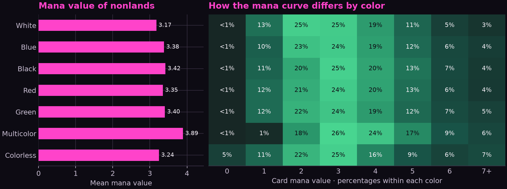

A planeswalker averages 55.82 words and just 0.24 tags. A creature averages 27.64 words and 0.85 tags. If I used keywords alone as my measure of how much there is to read on a card, I’d get those two the wrong way around.

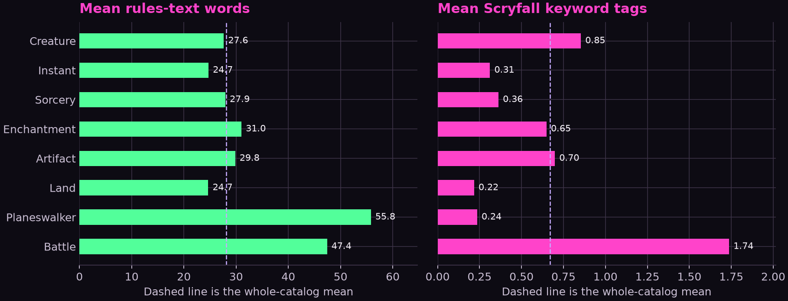

One thing I was unsure about was reminder text. Maybe newer cards look wordier because more of their mechanics come with an explanation in parentheses? Designs from 1995–99 average 20.2 words, against 35.7 for 2020–24. I removed the parenthetical text and got 17.2 and 28.2. I also tried just creatures, keeping the parentheses, and got 18.1 and 35.2. All three comparisons use the rules wording in my June 2026 Oracle snapshot, grouped by the year the design first appeared. To say what was actually printed on a 1995 card, I’d need its text from 1995. [Debut cohorts](results/exploration/design-eras.csv)

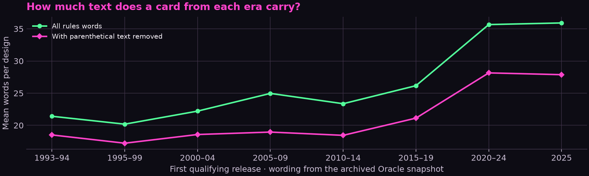

<details>
<summary>How I counted a design and its text</summary>

I kept each Oracle ID’s earliest eligible English paper printing through December 31, 2025. I dropped oversized cards, silver borders, acorn stamps, token layouts, emblems, art cards, memorabilia and minigame sets. I needed a known color, mana value and at least one of the eight types in the figure. I took the type, text and colors from the front face where supplied, using the card-level fields otherwise. Mana value and keyword tags come from the whole card, so a keyword can describe either face.

My original word-count function counts word-like tokens in the Oracle rules text, including numbers and the contents of mana symbols. Flavor text has its own field. I counted each Scryfall keyword tag as listed. For the reminder-text check I removed the parenthetical passages and ran the word count again. [Original features](https://github.com/UaDreamota/mtg_assetpricing/blob/b1653b98b2f724d8e7c361baa5ba463800796604/scripts/analysis/pre_regression.py) · [Census calculations](scripts/analysis/explore_collections.py)

</details>

## What did an expansion cost?

For the expansion basket I wanted one copy of each nonbasic booster card in its own set. I matched the regular `Name [SET]` paper quotes to English, nonpromo, nonoversized booster cards of the four ordinary rarities. Multiple versions of a name in the same set get one slot.

I took each printing’s median positive quote per day, then the median of those daily quotes over December 25–31. I wanted at least three quoted days. If I had no price for a card, I counted the empty slot. For a set with eligible names `U` and quoted names `Q`, here’s the subtotal and the share of the set I could price.

```math
V_s=\sum_{i\in Q_s}q_{is}, \qquad c_s=\frac{|Q_s|}{|U_s|}.
```

I could price at least 90% of the names in 46 sets. Giving each set equal weight, the mean subtotal was \$165.71 and the median was \$157.94. The average within-set quote was \$0.76 per covered card. I also tried an 80% cutoff (\$164.03 across 56 sets) and a 95% cutoff (\$159.59 across 26). All 59 sets had at least one missing quote. [Set values and missing slots](results/exploration/expansion-baskets.csv)

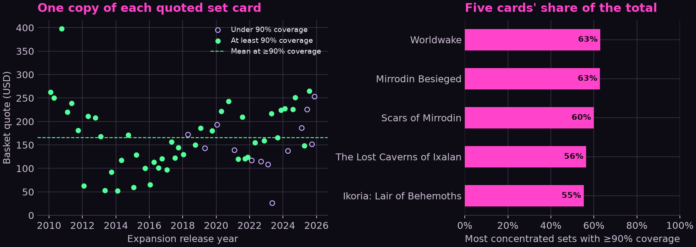

I could price 224 of the 229 eligible Scars of Mirrodin names for \$397.76. Mox Opal was \$187.01 of that, or 47% of the set. Take out the five most expensive cards and there’s \$159.45 left. Ixalan came to \$144.46 for 251 of 259 names, or \$98.09 after taking out its top five. On average, five cards accounted for 38.3% of the value across those 46 sets.

## How much of the over-a-dollar collection sits in 300 cards?

This time I used the cheapest covered printing of each name, under the same seven-day quote rule. I kept names strictly above a dollar, ranked them by price and counted one copy apiece.

Of 25,703 names with quotes, 21,903 were below a dollar and 148 landed on exactly \$1. The remaining 3,652 copies added up to \$81,841.95. Just 300 of them accounted for \$65,743.37. So 8.2% of the names held 80.3% of the value, and the top ten alone held 35.5%. If I put the same number of dollars into every name, the top 300 would have 8.2% of the weight.

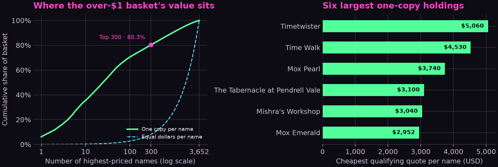

*Timetwister* came first at \$5,059.99 for its cheapest covered printing, `[2ED]`. It made up 7.7% of the top 300. The inverse sum of squared weights was 37.7, about the concentration of 38 equally sized holdings. *Twinflame Tyrant* `[FDN]` just made the cut at \$24.35. I also went looking for *Black Lotus*. There wasn’t a paper quote for it in my archive that week. [All 300 holdings and both sets of weights](results/exploration/top-300-holdings.csv)

## Are creatures or wordier cards more expensive?

I first looked at the 16,298 names with usable prices and features in my tournament panel. The panel includes names seen at any point in six archived formats. For each name I took the median across its printings’ last paper quotes in December. I wanted a price for the name and was willing to let more expensive printings count here. [Original monthly panel](https://github.com/UaDreamota/mtg_assetpricing/blob/b1653b98b2f724d8e7c361baa5ba463800796604/scripts/analysis/final_dataman.py)

The median came to 28¢, the mean to \$5.36, and 12,702 names (78%) were below a dollar. The median common was 20¢. Rares and mythics actually switch places depending on which average I take. For first-printing rares the median was \$0.75 and the mean \$13.89. For mythics it was \$1.99 and \$5.93.

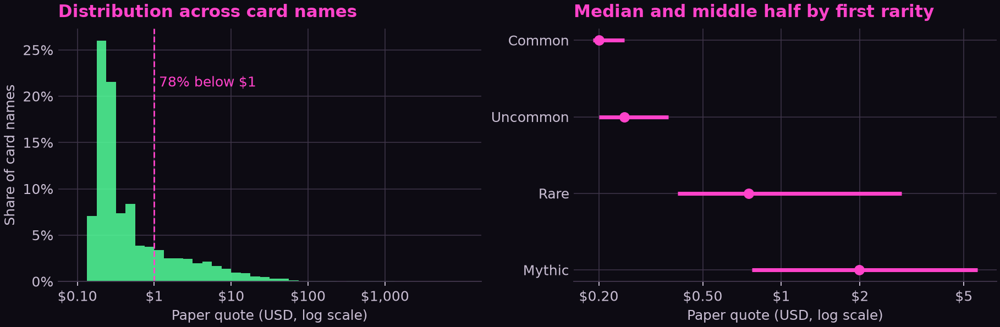

The median creature was 25¢ and the median noncreature 30¢. Among the 521 names with positive Standard exposure, I got 53¢ and 43¢ respectively. Here are the medians and the middle half of each group.

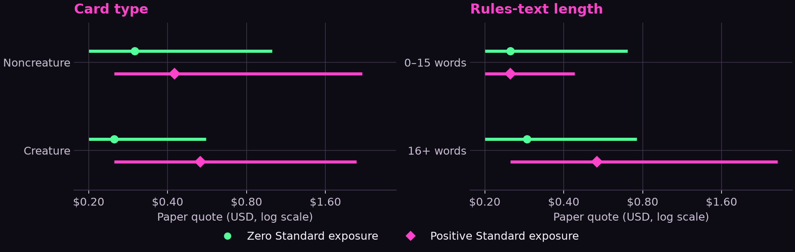

I tried more than 15 rules words as my cutoff for a long card. I’m still a bit unsure about that choice. It puts 77% of the sample on the long side. Among the cards with Standard exposure, there were 61 short names and 460 long ones. And the long cards didn’t get steadily more expensive. The median was 60¢ at 16–20 words, 46¢ at 21–30, and 40¢ at 61 words or more. [Counts and prices by word band](results/exploration/prices-by-word-count.csv)

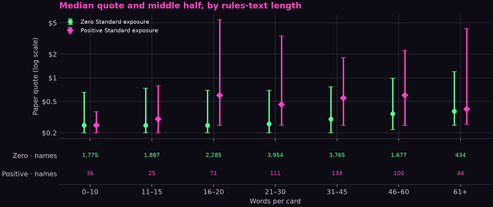

### How the comparison changes with Standard play

I let the creature and long-text estimates differ between names with zero and positive Standard exposure. That gave me four comparisons from one December fit.

I used my original exposure calculation. For each Standard archetype I multiplied its share of that month’s deck records (`s`) by the fraction of its downloaded lists containing the card (`p`). I summed across archetypes with at least five records, calculating the shares before applying that cutoff. A zero can mean that the card was outside Standard or that I didn’t see it in a qualifying archetype. [Original exposure code](https://github.com/UaDreamota/mtg_assetpricing/blob/b1653b98b2f724d8e7c361baa5ba463800796604/scripts/analysis/top8.py)

```math
E_i=\sum_{a:\,n_a\ge5}s_a p_{ia},\qquad D_i=\mathbf{1}[E_i>0].
```

<details>
<summary>Three fits on the same 16,298 names</summary>

I wrote `y` for the natural log of the monthly quote, `C` for a creature and `L` for a card with more than 15 words, including reminder text. I tried these three fits on the same names.

```math
\begin{aligned}
(1)\quad y_i &= \alpha+\beta_C C_i+\beta_L L_i+\epsilon_i\\
(2)\quad y_i &= \alpha_{s(i)}+\beta_C C_i+\beta_L L_i+\gamma^\top X_i+\epsilon_i\\
(3)\quad y_i &= \alpha_{s(i)}+\beta_C C_i+\beta_L L_i+\gamma^\top X_i+\delta_C C_iD_i+\delta_L L_iD_i+\epsilon_i .
\end{aligned}
```

In (2) and (3) I gave each first-printing set its own intercept. I controlled for first rarity, mana value, `ln(1 + months since the latest printing)`, Reserved List status, `D` and `ln(1 + 100E)`. For a card seen in Standard the creature slope in (3) is `β_C + δ_C`. I converted log differences to percentages with `100 × (exp(b) − 1)` and clustered the intervals by first-printing set (312 sets).

</details>

| December fit in the wider panel | Creature difference | 16+ words difference | In-sample R² |
|---|---:|---:|---:|
| (1) Card traits alone | −24.8% | +6.2% | 0.012 |
| (2) Common slopes with controls | −15.8% | −3.6% | 0.587 |
| (3) Zero Standard exposure | −16.2% | −5.3% | 0.589 |
| (3) Positive Standard exposure | −2.4% | +174.2% | same fit |

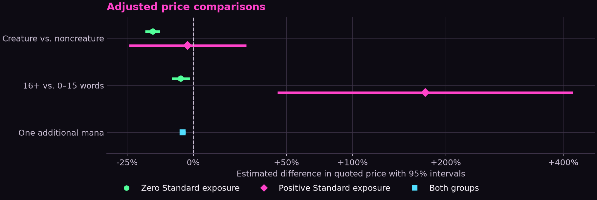

Among names with Standard exposure, the creature interval ran from 24% cheaper to 26% more expensive. For long text it ran from 44% to 421% more expensive. An extra mana went with 4.5% lower quotes in the shared mana slope. The large +174% estimate compares two groups around a cutoff, with only 61 short cards. Earlier I counted ten additional words, removed reminder text and pooled exposed and unexposed cards within each type. Here I’m comparing 460 exposed names against 61, using a cutoff and a different quote. That is a much narrower comparison. [Wider-panel coefficients and intervals](results/exploration/regression-coefficients.csv)

I repeated (3) in March, June, September and December 2025. The exposed creature interval included zero every time. The exposed long-text estimates were +108%, +113%, +159% and +174%. Moving the December cutoff to more than 10 or more than 20 words gave me +320% or +44%. Keeping 15 and dropping lands gave +107%. That’s quite a range for a decision I made just by looking at the length of a card. [Quarter-end and cutoff checks](results/exploration/summary.json)

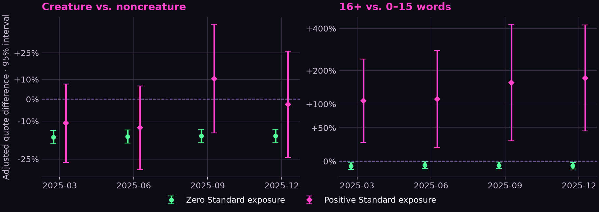

## Where I’d go next

I’m now building portfolios sorted on these card features. I want to see whether the groups that differ in price in December also differ in what they earn over the following month.

The first thing I’d try is the word-count comparison among Standard-legal cards of the same rarity and type. How many comparable short cards do I have left then? The other question I want to come back to is the binder. I have the set-specific quotes and the cheapest-copy quotes. If I price exactly the same list both ways, how much extra would I pay to make every card say Ixalan? [Research checklist](RESEARCH_CHECKLIST.md)

## Files and reproduction

I wrote the original card features and tournament-exposure code. I used AI on the monthly panel assembly and later analysis, including this write-up. The saved numbers come from Scryfall card metadata, MTGGoldfish paper quotes and MTGTop8 decklists. [Original feature code](https://github.com/UaDreamota/mtg_assetpricing/blob/b1653b98b2f724d8e7c361baa5ba463800796604/scripts/analysis/pre_regression.py) · [Analysis scripts](scripts/analysis)

From the repository root, this rebuilds the figures and CSVs from the two saved sets of results. I used Python 3.14.

```sh
python -m pip install numpy pandas scipy 'matplotlib>=3.7' threadpoolctl
python -m scripts.analysis.explore_card_prices --replay
```

For the December printing regressions, the local inputs are `data/default-cards-20260614090813.json`, `data/price_histories.parquet` and the Standard decklists under `data/mtgtop8/`. The wider exploration also reads `data/final_card_panel.parquet`. To rebuild that panel from the six formats’ decklists and the MTGBans timeline, run `scripts.analysis.top8` and `scripts.analysis.final_dataman` as Python modules first.

```sh
python -m pip install duckdb pyarrow requests rich
python -m scripts.analysis.card_prices
python -m scripts.analysis.explore_card_prices
```
