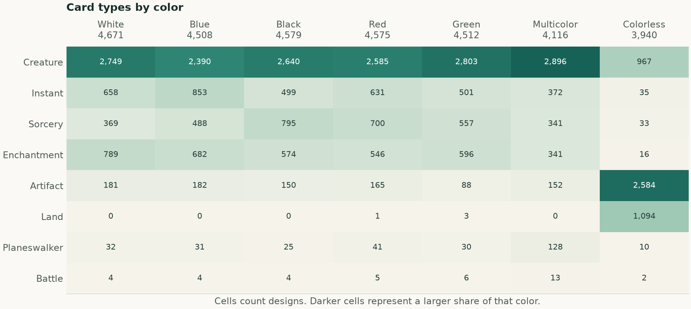
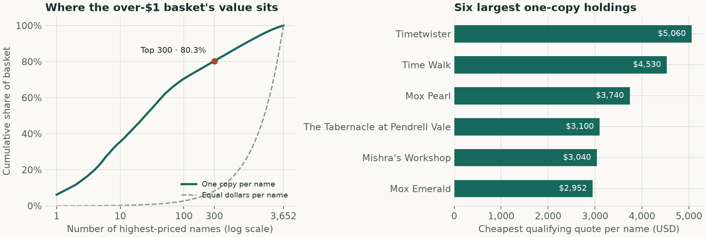
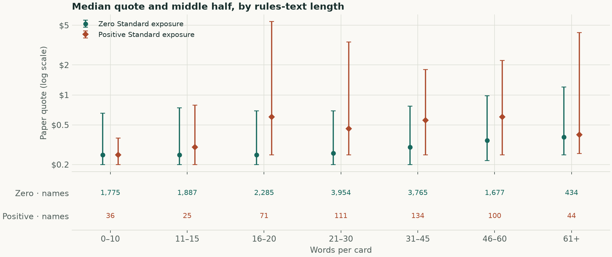

# What makes a Magic card expensive?

If you covered up the price of *Colossal Dreadmaw*, what would I have to go on? Six mana for a 6/6 with trample. I could look up how rare it is, how many times it was printed, and whether anyone plays it in Standard. I wanted to see how far I could get with that.

The first thing I got stuck on was *Opt*. A decklist just says “Opt.” For an Ixalan binder I want the Ixalan printing. To play the card I’d buy the cheapest copy I could find. So I started by counting designs, then priced those different collections in December 2025. [Original Ixalan file](data/xln_cards.csv)

## What is on a card?

My Ixalan file has 289 printing records for 274 names. The five basic lands have four illustrations apiece. For the census I counted each design once by its Scryfall Oracle ID and got 30,901 paper designs released by the end of 2025. A blue-red card goes in the multicolor column. An artifact creature counts in both type rows. [Type and color counts](results/exploration/type-color-counts.csv)



| Color | Mean rules words | Mean keyword tags | Mean mana value, nonlands |
|---|---:|---:|---:|
| White | 25.86 | 0.70 | 3.17 |
| Blue | 27.45 | 0.73 | 3.38 |
| Black | 27.51 | 0.65 | 3.42 |
| Red | 27.69 | 0.63 | 3.35 |
| Green | 27.44 | 0.66 | 3.40 |
| Multicolor | 34.05 | 0.82 | 3.89 |
| Colorless | 27.19 | 0.48 | 3.24 |

The average card has 28.1 words and 0.67 keyword tags. A planeswalker averages almost 56 words and only 0.24 tags. I counted the Oracle rules text on the front face where available, including reminders, and used Scryfall’s keyword list for the whole card. I left lands out of the mana column. Putting them back takes the colorless mean from 3.24 to 2.34. [Mana curves](figures/mana-by-color.png) · [Words and keywords by type](figures/rules-and-keywords.png) · [Color averages](results/exploration/color-profiles.csv)

## What would the binder cost?

I took one copy of each nonbasic booster card from common through mythic in its own expansion. For each regular printing I used the median of its daily paper quotes on December 25–31, requiring at least three quoted days. I could price at least 90% of the eligible names in 46 of 59 expansions released since 2010. Their covered subtotals averaged \$165.71 per set, with a median of \$157.94. Every set had at least one missing quote. [Expansion values and coverage](results/exploration/expansion-baskets.csv) · [Expansion plot](figures/expansion-baskets.png)

In Scars of Mirrodin, 224 of 229 cards came to \$397.76. *Mox Opal* alone was \$187.01. Ixalan came to \$144.46 for 251 of 259 cards.

What if I just wanted one copy of each name, regardless of set? I took the cheapest covered printing of each name, kept the ones strictly above \$1 and ranked them by price. One copy of all 3,652 names added up to \$81,841.95. The most expensive 300 accounted for \$65,743.37, or 80.3% of the value. *Twinflame Tyrant* just made the cut at \$24.35. [All 300 holdings](results/exploration/top-300-holdings.csv)



## First results

Back to *Colossal Dreadmaw*. Its Ixalan printing was quoted at 20¢. With its name held out, the creature regression put it at 19¢. I tried the same exercise with *Mox Opal*. The noncreature regression put it at \$5.33 against that \$187.01 quote. The model sees a zero-mana artifact that can produce mana. How much is it worth to have those features together once metalcraft is active? That part is hard to read off a single coefficient.

I used each name’s oldest regular expansion printing with a qualifying final-week quote. I fit creatures and noncreatures separately across 58 expansions. I started with expansion, rarity, the fraction of downloaded Standard lists containing the card, estimated supply, and how many covered expansions printed it. Then I added mana, color, rules text and the traits specific to each group. I held out whole card names in five folds within each expansion.

| December fit | Names | Held-out R², controls only | With card features |
|---|---:|---:|---:|
| Creatures with numeric power and toughness | 6,424 | 0.626 | 0.633 |
| Single-type noncreatures | 5,862 | 0.511 | 0.554 |

Going from zero to 1% of Standard decklists went with 54% higher fitted quotes for creatures and 39% for noncreatures. Ten extra rules words, after removing reminders, went with 3% and 7% lower quotes respectively. Flying looked promising on its own. Flying creatures had an 18.7% higher geometric mean price. After adjustment the gap was −3.3%, with a 95% interval from −7.8% to +1.4%. [Coefficients, intervals and held-out card prices](results/card_table/prices.json)

What about a Dinosaur versus a Merfolk of the same rarity, stats and measured abilities? I added artifact-creature status and the 69 printed subtypes that each appeared on at least 30 names across five or more expansions. Dinosaurs came out 21.5% above Merfolk (95% interval +8.4% to +36.2%, Holm-adjusted `p = 0.0023`). On a 25¢ Merfolk that’s about five cents. The Merfolk–Human gap was −2.0%, with an interval spanning zero.

### Was 15 words a good cutoff?

I tried this a second way in my wider tournament panel. For 16,298 names I took the median across printings’ last paper quotes in December. The median name cost 28¢ and the mean was \$5.36. Creatures cost 25¢ at the median against 30¢ for noncreatures. Among the 521 names with positive Standard exposure, those medians were 53¢ and 43¢. [Price distribution by rarity](figures/paper-price-distribution.png)

My “long” group was any card with more than 15 words, including reminders. With the controls below, longer cards were 5% cheaper among names with zero Standard exposure and 174% more expensive among names with positive exposure. I’m still unsure about 15. There were only 61 short cards in that second group. Moving the cutoff to 20 words brought the estimate down to 44%. I’d try the comparison within the same rarity and type among Standard-legal cards before moving on to portfolio sorts. [Adjusted gaps](figures/adjusted-price-gaps.png) · [Word-band counts](results/exploration/prices-by-word-count.csv)



<details>
<summary>The equations I used</summary>

For the separate creature and noncreature fits, `q` is the regular printing’s quote, `R` its rarity, `d` its Standard deck share, `S` its estimated cumulative supply across covered expansions and `J` its number of expansion issues. The baseline uses the expansion intercept and market controls. The full model adds the card features `Z`.

```math
\ln q_i=\alpha_{s(i)}+\rho^\top R_i+\beta_d\ln(1+100d_i)+\beta_s\log_2 S_i+\beta_j\log_2 J_i+\theta^\top Z_i+\epsilon_i.
```

For supply I divided estimated release-family revenue by net revenue per card. I allocated that many cards across names using the booster rarity slots, then summed across covered reprints. For the Dinosaur comparison I added the subtype indicators to the full creature fit and took the difference between the two slopes. Intervals are clustered by expansion. I applied the Holm correction across the three subtype comparisons. [Set size estimates in millions](data/expansion_sizes.csv) · [Regression code](scripts/analysis/card_prices.py)

For the wider panel, `y` is the log of the monthly quote, `C` indicates a creature, `L` means 16+ words, and `D` means positive Standard exposure. I calculated exposure `E` by summing each qualifying archetype’s share of Standard deck records times the fraction of its lists containing the card. I kept archetypes with at least five records. A zero also covers cards outside the format.

```math
\begin{aligned}
y_i &= \alpha+\beta_C C_i+\beta_L L_i+\epsilon_i\\
y_i &= \alpha_{s(i)}+\beta_C C_i+\beta_L L_i+\gamma^\top X_i+\epsilon_i\\
y_i &= \alpha_{s(i)}+\beta_C C_i+\beta_L L_i+\gamma^\top X_i+\delta_C C_iD_i+\delta_L L_iD_i+\epsilon_i .
\end{aligned}
```

Here `s(i)` is the first-printing set. `X` includes first rarity, mana value, `ln(1 + months since the latest printing)`, Reserved List status, `D` and `ln(1 + 100E)`. I report `100 × (exp(b) − 1)` for a log-price difference `b` and cluster the intervals by first set. [Wider-panel coefficients](results/exploration/regression-coefficients.csv) · [Original exposure calculation](scripts/analysis/top8.py)

</details>

## Running it

From the repository root, this rebuilds the plots and tables from the saved numbers.

```sh
python -m pip install numpy pandas scipy 'matplotlib>=3.7' threadpoolctl
python -m scripts.analysis.explore_card_prices --replay
```

For the raw fits I used the June 2026 Scryfall snapshot, MTGGoldfish paper quotes and the archived MTGTop8 decklists. The card fits read `data/default-cards-20260614090813.json`, `data/price_histories.parquet` and `data/mtgtop8/`. The wider exploration also uses the original monthly panel. To build that panel from the six formats’ decklists and the MTGBans timeline, run `scripts.analysis.top8` and `scripts.analysis.final_dataman` as Python modules first.

```sh
python -m pip install duckdb pyarrow requests rich
python -m scripts.analysis.card_prices
python -m scripts.analysis.explore_card_prices
```

I wrote the original card features and tournament-exposure code. I used AI on the monthly panel assembly and later analysis, including this write-up.
